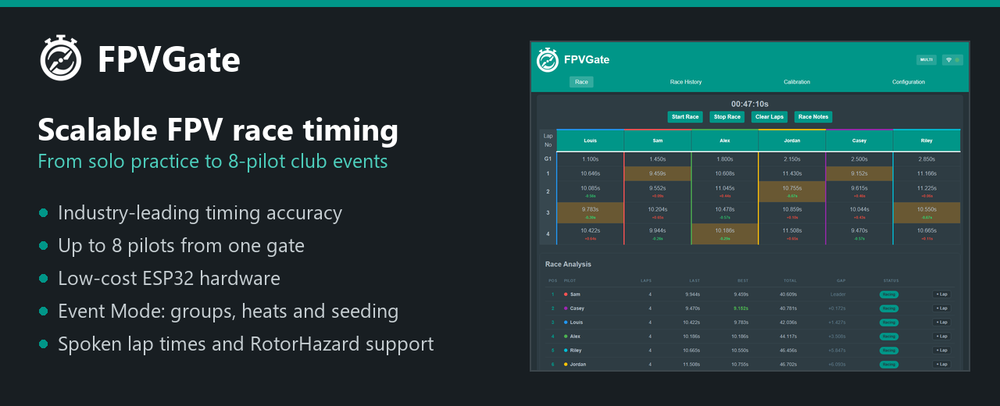
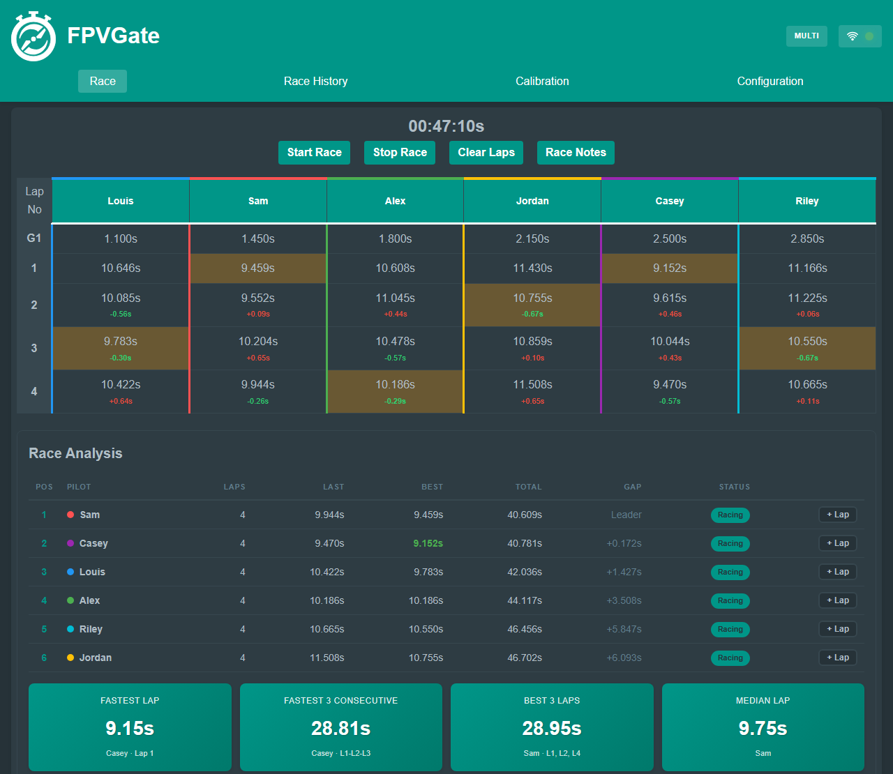
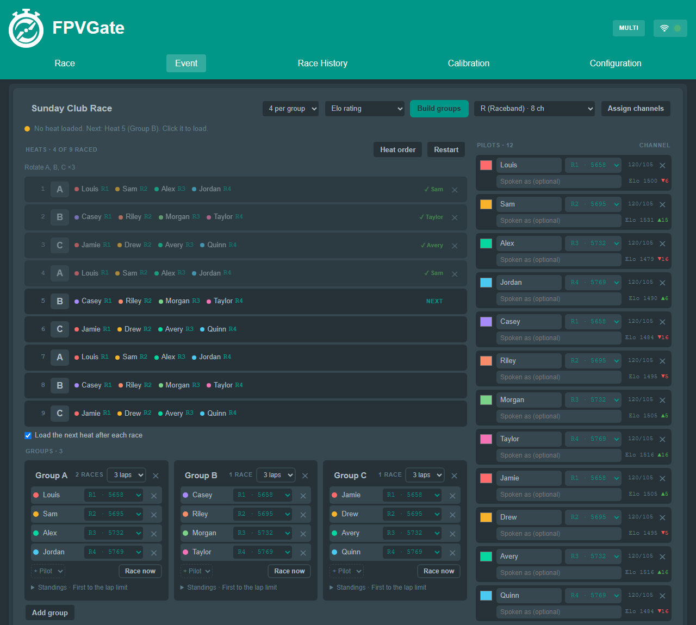
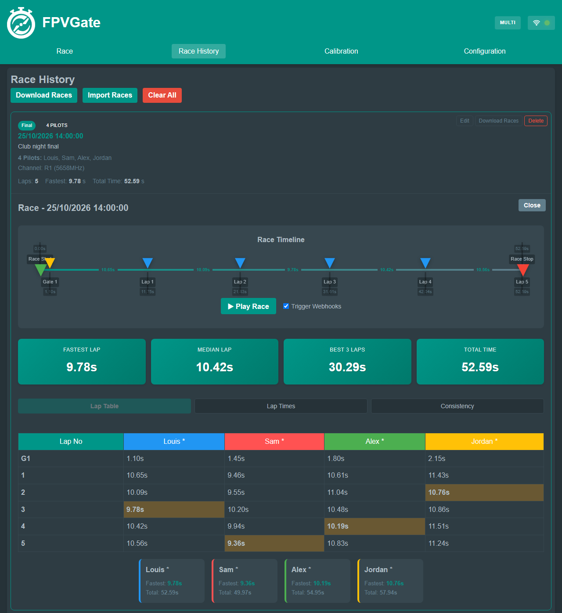
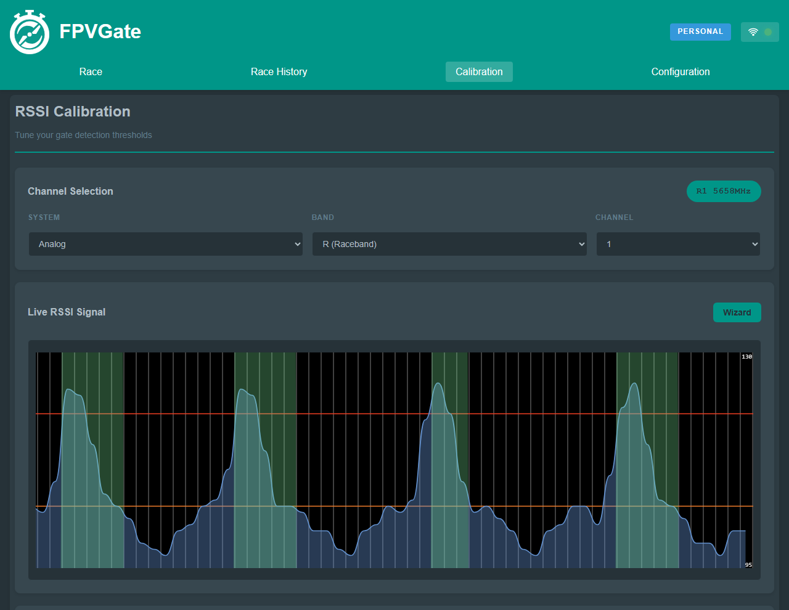
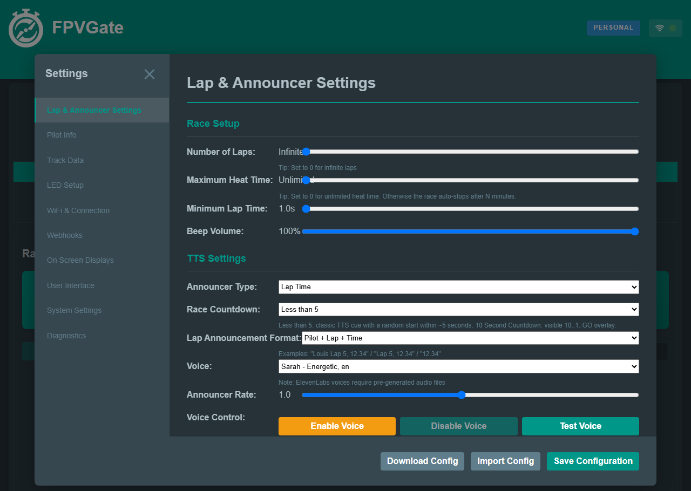
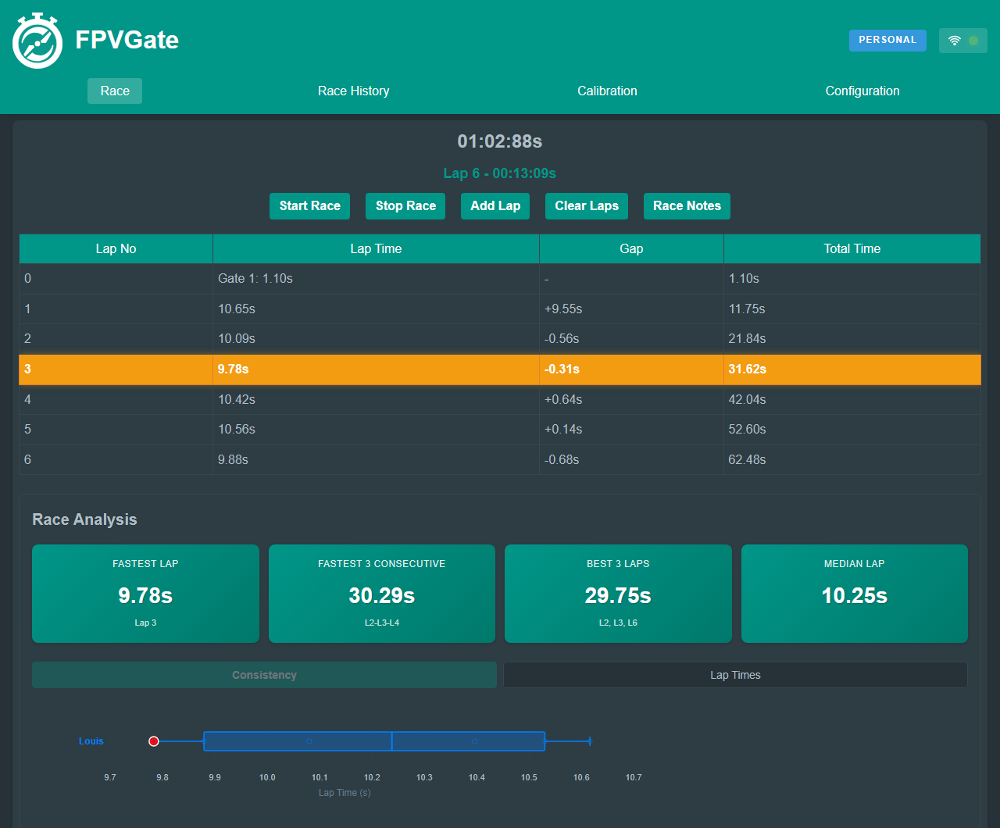
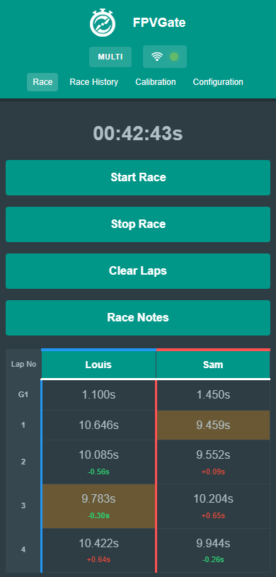
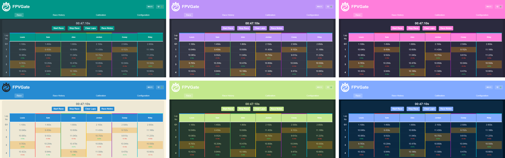

# FPVGate



[](https://github.com/LouisHitchcock/FPVGate/releases/latest)
[](https://github.com/LouisHitchcock/FPVGate/stargazers)
[](LICENSE)
[](https://fpvgate.xyz/c5.html)
[](docs/ROTORHAZARD_INTEGRATION.md)
[](https://discord.gg/XwammuWCCj)
[](https://ko-fi.com/louishitchcock)

**[Website](https://fpvgate.xyz)** ·
**[Web flasher](https://fpvgate.xyz/flasher.html)** ·
**[Shop](https://fpvgate.xyz/shop.html)** ·
**[Docs](#documentation)** ·
**[FAQ](#faq)**

FPVGate is low-cost, scalable FPV race timing, from solo practice to 8-pilot
club events. It times 5.8 GHz drone laps from the video signal each quad
already transmits, using inexpensive ESP32 boards. Start with one pilot on a
single gate, then grow to eight pilots from one ESP32-C5 receiver, full club
events with heats and seeding, or a RotorHazard race. No transponders, no
Raspberry Pi: open the gate in any browser and fly.

## Why FPVGate

| | |
|---|---|
| **Industry-leading timing accuracy** | On average, FPVGate's maximum lap-time deviation is 20 ms lower than an 8-node RX5808 timer's. Every pass is timed at the peak of the signal, and the ESP32-C5 timestamps each pilot's readings about 1000 times a second. |
| **Low cost** | Built on inexpensive ESP32 boards and receivers, with free firmware you flash from your browser. Or buy a ready-made gate from the [shop](https://fpvgate.xyz/shop.html). |
| **Scales with your group** | One pilot on an RX5808 gate, up to eight from one ESP32-C5, Event Mode for club days, and RotorHazard for bigger events. |
| **Event Mode** | Pilot roster, groups, race formats, heat scheduling, and Elo or lap-time seeding, saved on the gate. |
| **Spoken lap times** | Lap times read out by pre-recorded ElevenLabs voices in English, German, Spanish and French, with phonetic pilot names. |
| **Race analysis** | Live standings, gaps, fastest lap, fastest 3 consecutive (RaceGOW), lap and consistency charts, race history and notes. |
| **Visual Marshal** | Review any race on its recorded RSSI graph and correct its laps. |
| **Plug in and fly** | The gate makes its own Wi-Fi network for any phone or laptop, with USB-C networking (Windows and Linux) and wired Ethernet on the Waveshare S3-ETH. |
| **Make it yours** | 23 built-in themes plus custom colours, and an interface in English, German, Spanish, French and Simplified Chinese. |

## From one pilot to a full club event

| | Pilots | What you need |
|---|---|---|
| **Solo practice** | 1 | An ESP32-S3 timer with an SPI-modded RX5808, or a ready-made [FPVGate AIO](https://fpvgate.xyz/shop.html) |
| **Group racing** | Up to 8 per gate | An ESP32-C5 receiver running [FPVGate C5MK](https://github.com/LouisHitchcock/FPVGateC5MK), or the FPVGate C5MK AIO |
| **Club events** | Any size roster | Event Mode with an ESP32-C5: groups of up to eight race in turn, with automatic heat loading and seeding |
| **RotorHazard races** | Every RH seat | The [FPVGate RotorHazard plugin](https://github.com/LouisHitchcock/fpvgate-rh-plugin): every pilot, live RSSI, and frequencies set from RotorHazard |

With an ESP32-C5, each pilot gets their own channel, calibration and
results. The gate runs the race itself: each racer finishes at the lap limit,
and the race stops and saves when everyone is done or the heat time runs out,
even with no browser open.

## Screenshots



| Event Mode | Race history |
|:---:|:---:|
|  |  |
| **Calibration** | **Settings** |
|  |  |

<details>
<summary><b>Single-pilot race and phone view</b></summary>
<br>

<p>
  
  
</p>

</details>

Screenshots use demo race data.

### Themes



Choose from 23 built-in themes, including Material, Dracula, Monokai, One
Dark, Solarized, Night Owl and Synthwave, or set your own colours, under
**Configuration > User Interface**.

## Get started

### 1. Get the hardware

> [!TIP]
> **Want it ready to go?** The [FPVGate AIO](https://fpvgate.xyz/shop.html)
> is a pre-built gate: no soldering, wiring or flashing.

To build your own:

| Component | Required | Notes |
|---|---|---|
| ESP32-S3 timer board | Yes | [Seeed Studio XIAO ESP32S3](https://wiki.seeedstudio.com/xiao_esp32s3_getting_started/) (recommended), ESP32-S3-DevKitC-1 (8 MB) or [Waveshare ESP32-S3-ETH](docs/WAVESHARE_S3_ETH.md) |
| Receiver | Yes | An RX5808 with the [SPI mod](https://sheaivey.github.io/rx5808-pro-diversity/docs/rx5808-spi-mod.html) for one pilot, or an ESP32-C5 board with a 5 GHz antenna for up to eight |
| MicroSD card | Yes | FAT32, 1 GB or more, for voices and race data |
| 5 V power | Yes | USB or any 5 V source |
| WS2812 RGB LEDs | Optional | 1–2 LEDs for visual feedback |
| Active buzzer | Optional | 3.3–5 V, for beeps |

Wiring: [XIAO ESP32S3](docs/wiring/Seeed-XIAO-ESP32S3.md) ·
[ESP32-S3-DevKitC-1](docs/wiring/ESP32-S3-DevKitC-1.md) ·
[Waveshare ESP32-S3-ETH](docs/WAVESHARE_S3_ETH.md) ·
[ESP32-C5 receiver](https://fpvgate.xyz/c5.html#boards).
The [hardware guide](docs/HARDWARE_GUIDE.md) covers components and troubleshooting.

### 2. Flash the firmware

Open the **[web flasher](https://fpvgate.xyz/flasher.html)** in Chrome, Edge
or Opera, connect the board over USB, pick your board and press Flash. It
takes 2–3 minutes. Supported boards: Seeed XIAO ESP32S3, ESP32-S3-DevKitC-1,
Waveshare ESP32-S3-ETH, FPVGate AIO, FPVGate Solo and FPVGate C5MK AIO.

Using an ESP32-C5 receiver? Flash it with the
[C5 flasher](https://fpvgate.xyz/c5.html#flasher) too. After that, FPVGate
can update the C5 over its link from **Settings > System**.

> [!NOTE]
> **Upgrading from 1.7.x?** Flash once with the web flasher. 1.8 changed the
> partition table, so an over-the-air update from 1.7.x won't work. Later
> updates can go over the air.

<details>
<summary><b>Flash from the command line, or build from source</b></summary>
<br>

Download your board's files from the
[releases page](https://github.com/LouisHitchcock/FPVGate/releases), then:

```bash
esptool.py --chip esp32s3 --port COM3 write_flash -z \
  0x0 [BOARD]-bootloader.bin \
  0x8000 [BOARD]-partitions.bin \
  0x10000 [BOARD]-firmware.bin \
  0x410000 [BOARD]-littlefs.bin
```

The Waveshare ESP32-S3-ETH (16 MB) puts the filesystem at `0x610000`.

Or build with [PlatformIO](https://platformio.org/):

```bash
git clone https://github.com/LouisHitchcock/FPVGate.git
cd FPVGate
pio run -e ESP32S3 -t upload      # ESP32-S3-DevKitC-1 (8 MB)
pio run -e ESP32S3 -t uploadfs
```

The [development guide](docs/DEVELOPMENT.md) lists every board target.

</details>

### 3. Connect and race

1. Join the `FPVGate_XXXX` Wi-Fi network (password `fpvgate1`), or plug in
   USB-C on Windows or Linux.
2. Open `http://fpvgate.local` or `http://192.168.4.1` (over USB:
   `http://192.168.7.1`).
3. With an ESP32-C5, set **Configuration > Receiver Module** to ESP32-C5
   and add your pilots.
4. Set each pilot's channel and calibrate the thresholds in **Calibration**.
5. Start racing.

The [getting started guide](docs/GETTING_STARTED.md),
[user guide](docs/USER_GUIDE.md) and
[multi-pilot guide](docs/C5_MULTI_PILOT.md) go into detail.

## How it works

FPVGate tunes a receiver to each pilot's video channel and samples the signal
strength continuously. When the signal rises above **Enter**, a crossing
starts; when it falls below **Exit**, FPVGate records the lap at the peak, the
moment the quad was closest to the gate. An ESP32-C5 receiver hops between up
to eight channels, measuring each one about 1000 times a second.

```
RSSI  │     /\
      │    /  \
      │   /    \     ← one clean peak per pass
Enter ├──/──────\───
      │ /        \
Exit  ├/──────────\─
      └─────────────── time
```

<details>
<summary><b>All features</b></summary>
<br>

**Timing and racing**
- Up to 8 pilots per gate with an ESP32-C5 receiver, each with their own channel and calibration
- Gate-managed races: per-pilot lap limits, heat time limits and history saved on the gate
- Event Mode: roster, groups, race formats, heat order, Elo or lap-time seeding, standings
- Calibration wizard with ignore regions and editable results

**Race analysis**
- Live standings with gaps and fastest-lap highlighting
- Fastest 3 consecutive laps (RaceGOW format), best 3 laps and median lap
- Lap time and consistency charts
- Race history with export/import, tagging, naming and notes
- Visual Marshal: review and correct laps on the recorded RSSI graph

**Voice and interface**
- Pre-recorded ElevenLabs voice packs in English, German, Spanish and French, and PiperTTS
- Phonetic name support and configurable announcement formats
- 23 built-in themes plus custom colours
- Interface in English, German, Spanish, French and Simplified Chinese
- OSD overlay for live streaming

**Connectivity and integration**
- Wi-Fi access point, USB-C networking (Windows and Linux) and wired Ethernet (Waveshare S3-ETH)
- RotorHazard plugin: every pilot, live RSSI, frequencies from RotorHazard, clock sync and lap submission
- Webhooks for race start/stop and laps, with gate LED control
- RGB LED indicators with 10 presets

**Tracks and storage**
- Up to 50 track profiles with distance, images and notes
- SD card storage for audio and race data, with config backup and restore

**Updates and diagnostics**
- Over-the-air updates from a file or straight from fpvgate.xyz
- ESP32-C5 receiver updates over the gate's link, with automatic rollback
- Built-in self-test diagnostics

</details>

<details>
<summary><b>Supported channels</b></summary>
<br>

*Analog:*
- **A (Boscam A):** 5865, 5845, 5825, 5805, 5785, 5765, 5745, 5725
- **B (Boscam B):** 5733, 5752, 5771, 5790, 5809, 5828, 5847, 5866
- **E (Boscam E):** 5705, 5685, 5665, 5645, 5885, 5905, 5925, 5945
- **F (Fatshark):** 5740, 5760, 5780, 5800, 5820, 5840, 5860, 5880
- **R (Raceband):** 5658, 5695, 5732, 5769, 5806, 5843, 5880, 5917
- **L (Lowband):** 5362, 5399, 5436, 5473, 5510, 5547, 5584, 5621

*Digital:*
- **DJI:** v1-25, v1-25CE, v1_50, 03/04-20, 03/04-20CE, 03/04-40, 03/04-40CE, 04-R
- **HDZero:** R, E, F, CE
- **Walksnail:** R, 25, 25CE, 50

The ESP32-C5 receiver covers 5180–5917 MHz, so Boscam E7 and E8 need an RX5808.

</details>

## FAQ

**How accurate is FPVGate?**
On average, its maximum lap-time deviation is 20 ms lower than an 8-node
RX5808 timer's. Each pass is timed at the peak of the signal, the moment the
quad is closest to the gate.

**How many pilots can it time?**
One per gate with an RX5808, or up to eight from one gate with an ESP32-C5
receiver. Event Mode runs larger rosters as groups that race in turn.

**Do I need a Raspberry Pi or RotorHazard?**
No. FPVGate is a standalone timer with its own web interface. If your club
runs RotorHazard, FPVGate joins it through the
[RotorHazard plugin](docs/ROTORHAZARD_INTEGRATION.md).

**What do I need to build one?**
An ESP32-S3 board, a receiver (an SPI-modded RX5808 or an ESP32-C5), a
microSD card and 5 V power. Flash it from your browser with the
[web flasher](https://fpvgate.xyz/flasher.html), or buy a ready-made gate
from the [shop](https://fpvgate.xyz/shop.html).

**Does it work with DJI, HDZero or Walksnail?**
FPVGate has channel presets for DJI, HDZero and Walksnail as well as the
analog bands. It measures signal strength rather than decoding the video.

**How is FPVGate related to PhobosLT?**
FPVGate began as a fork of [PhobosLT](https://github.com/phobos-/PhobosLT)
and has since added multi-pilot timing, Event Mode, spoken lap times, race
analysis, the Visual Marshal, USB networking, over-the-air updates and
RotorHazard integration.

## Documentation

| Guide | Contents |
|---|---|
| [Getting started](docs/GETTING_STARTED.md) | Hardware, wiring, flashing and first setup |
| [User guide](docs/USER_GUIDE.md) | Connecting, calibrating, racing and every feature |
| [Multi-pilot with an ESP32-C5](docs/C5_MULTI_PILOT.md) | Wiring, setup and calibration for up to eight pilots |
| [Gate race completion](docs/GATE_RACE_COMPLETION.md) | How the gate finishes and saves multi-pilot races |
| [Hardware guide](docs/HARDWARE_GUIDE.md) | Components, wiring diagrams, troubleshooting |
| [Features](docs/FEATURES.md) | In-depth feature documentation |
| [RotorHazard integration](docs/ROTORHAZARD_INTEGRATION.md) | Connecting FPVGate to RotorHazard |
| [USB networking](docs/USB_NETWORKING.md) | The web UI over USB-C |
| [Waveshare ESP32-S3-ETH](docs/WAVESHARE_S3_ETH.md) | The wired Ethernet board |
| [Voice generation](docs/VOICE_GENERATION_README.md), [multi-voice setup](docs/MULTI_VOICE_SETUP.md) | Custom and multiple voices |
| [Development](docs/DEVELOPMENT.md) | Building from source and contributing |
| [Changelog](CHANGELOG.md) | Every release |

## What's new in 1.9.0

- **Up to 8 pilots per gate** with an ESP32-C5 receiver running FPVGate C5MK
- **Event Mode** for club events: groups, formats, heat scheduling and seeding
- **Gate-managed races** that finish and save on the gate, even with no browser open
- **RotorHazard plugin 2** support: every pilot, live RSSI and frequencies from RotorHazard
- **More accurate timing**, with matching peak timestamps for RotorHazard passes and RSSI history
- **New boards:** FPVGate C5MK AIO and Waveshare ESP32-S3-ETH with wired Ethernet

The [changelog](CHANGELOG.md) covers every release.

## Community

- **Chat and help:** [Discord](https://discord.gg/XwammuWCCj)
- **Bugs and feature requests:** [GitHub Issues](https://github.com/LouisHitchcock/FPVGate/issues)
- **Questions and ideas:** [GitHub Discussions](https://github.com/LouisHitchcock/FPVGate/discussions)
- **Support development:** [Ko-fi](https://ko-fi.com/louishitchcock), or
  [buy a gate](https://fpvgate.xyz/shop.html)

If FPVGate is useful to you, a ⭐ helps other pilots find it.

## Credits

FPVGate is a heavily modified fork of [PhobosLT](https://github.com/phobos-/PhobosLT)
by phobos-, which provided the foundation for RSSI lap timing. Portions of the
timing logic are inspired by [RotorHazard](https://github.com/RotorHazard/RotorHazard).
[CONTRIBUTORS.md](CONTRIBUTORS.md) lists everyone who has contributed.

## Licence

[CC BY-NC-SA 4.0](https://creativecommons.org/licenses/by-nc-sa/4.0/): free to
share and adapt for non-commercial use, with attribution, under the same
licence. See [LICENSE](LICENSE).
