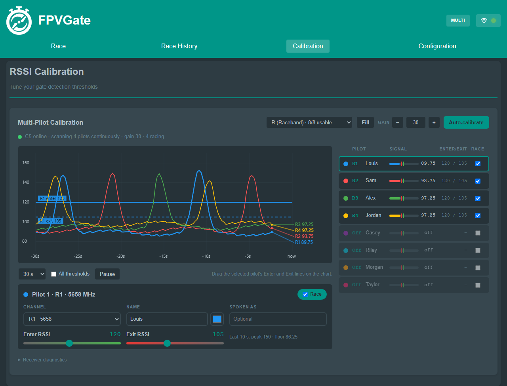

# FPVGate user guide

For `V1.9.0-alpha` / `1.9.0-alpha-5`. Start with
[Getting started](GETTING_STARTED.md) for wiring, flashing and SD preparation.
This guide describes current behavior rather than older release procedures.

## Connecting to FPVGate

| Connection | Address and behavior |
| --- | --- |
| Wi-Fi access point | Join `FPVGate_XXXX`, password `fpvgate1`; open `http://192.168.4.1` |
| Wi-Fi station | Enter your network credentials in WiFi & Connection, apply/reboot, then use the router-assigned address |
| USB networking | Native USB on the six shipping targets; open `http://192.168.7.1` on Windows/Linux |
| Ethernet | S3-ETH: DHCP; after 45 s without a lease, fixed `192.168.8.1/24` |

`http://fpvgate.local` is a convenience when mDNS works. Use IP addresses
for several gates on one network and when a phone cannot resolve the name.
The AP firmware sets channel 6 and permits four clients; those clients are
viewers/controllers, not the number of timed pilots.

Wi-Fi station failure on initial connection falls back to the access point.
Saved credentials and router availability determine the startup mode. USB
networking coexists with Wi-Fi. On S3-ETH it is suspended while the Ethernet
link is up; direct Ethernet needs your computer set to an address such as
`192.168.8.2/24` because the fallback is not a laptop DHCP server.

### USB connection (ESP32-S3, firmware 1.8.0 and later)

The supported builds expose RNDIS networking and CDC serial together.
No COM-port selection is needed in the web page. Use a data-capable cable
and the native USB connector. A USB-to-UART bridge is a different port.
macOS does not provide the RNDIS support used by this firmware; use Wi-Fi
or Ethernet. Retained LCD, LilyGO, Super Mini and Plus source targets do not
define the USB-network flag. See [USB networking](USB_NETWORKING.md).

If USB does not return after flashing, unplug/replug and check that the board
has left its bootloader. If needed, enter BOOT recovery and flash the correct
release again. Close serial monitors while flashing.

## Web interface overview

Race shows live standings and lap/consistency charts. Calibration sets detection
thresholds. Race History lists saved races and the editor. Settings opens grouped
configuration, network, interface, system and diagnostics controls. Event Mode
adds an Event tab for C5 club sessions.

Settings generally save through the page. Wait for Save/Saved feedback before
starting a heat or disconnecting. Wi-Fi application and firmware updates have
their own reboot behavior.

## Configuration

### Receiver and pilot information

RX5808 and Novacore are conventional single-receiver modes. Novacore has
separate filter controls. ESP32-C5 provides up to eight frequency slots with
names, spoken names, colors, Enter/Exit levels and Race participation.
C5MK AIO forces C5 at defaults, saved-config load and attempted receiver changes.

For a C5, use Calibration's cards for each pilot. An unticked Race slot can
still scan for observation; a frequency of Off disables that slot. Stop before
changing participation, frequency, gain or thresholds. C5 frequencies are
5180–5917 MHz; Boscam E7/E8 are outside that range. Choose channels appropriate
to local RF rules and your transmitters.

### Race setup

| Setting | Meaning |
| --- | --- |
| Number of Laps | 0 is unlimited; page slider is 0–50 real laps |
| Minimum Lap Time | Stored in tenths of a second, 0.1–20.0 s; default 2.0 s |
| Maximum Heat Time | 0 unlimited; otherwise 30-second blocks up to 30 minutes |
| Countdown | Classic "Less than 5" with randomized delay, or 10-second countdown |

Gate 1 does not count toward the lap limit. The C5 controller accepts at most
63 real laps because the per-pilot array holds 64 crossings including Gate 1.
Unlimited does not mean unbounded storage. A DNS pilot never reaches a lap
limit; set a heat limit or stop manually.

### Announcer and voice settings

None, Beep, Lap Time, 2 Consecutive and 3 Consecutive control browser callouts.
The consecutive modes use rolling totals of that pilot's last two/three real
laps, excluding Gate 1, once enough laps exist. Pilot/Lap/Time, Lap/Time and
Time Only control the single-pilot phrase format.

Select Sarah/default, Rachel, Adam, Antoni, Matilda, German, Spanish, French
or Web Speech. Pre-recorded MP3s come from the selected SD voice directory;
missing phrases can fall back to the browser's Web Speech. There is no
bundled Piper synthesizer. C5 pilot-name/time speech can use Web Speech
directly, so offline behavior depends on the installed browser voices.

Tap/click Enable Audio before racing, especially on mobile. Browser volume
and buzzer volume are independent. Speech rate is configurable (0.1–2.0);
firmware default is 1.0, while the announcer class starts at 1.3 before config
loads. Keep a page open for spoken announcements.
See [voice packs](MULTI_VOICE_SETUP.md).

## Calibration

Use the actual antenna, transmitter power, mounting and racing environment.
Observe background RSSI first; then record several representative passes.

Enter must be above noise but below the pass peak. Exit should be lower than
Enter. Test slow passes and normal-speed passes, and set a minimum lap time
that rejects retriggers without rejecting a valid lap. Recalibrate after
changing RF gain, antenna, power or placement.

The RX5808 wizard records passes, supports ignoring noisy sections and lets
you review calculated thresholds/minimum lap time before saving.
C5 calibration operates per pilot and can calculate several pilots together;
weak/no-pass captures retain their existing thresholds. Follow the
[C5 calibration guide](C5_MULTI_PILOT.md#setting-enter-and-exit).

## Racing

1. Confirm receiver online, correct racers/channels, calibration, saved settings
   and voice playback.
2. Start and wait for the countdown.
3. The first crossing is Gate 1; lap 1 is the next crossing minus Gate 1.
4. Stop manually or let the applicable lap/heat limits stop the race.
5. Wait for history persistence before Clear or power-down.

In C5 mode the S3 owns completion and history. Each pilot stops accumulating
laps at their own limit; the race ends when all racers finish or the heat
limit/manual Stop fires. A failed save stays in RAM and blocks Start/Clear.
Fix storage and retry Stop. A successful HTTP stop only queues work: clients
must wait until the gate is no longer busy and the save has completed.

Closing every browser does not stop a C5 race or its automatic save. Unreleased
alpha source also records Event results/loads the next heat on the gate;
published Alpha 5 images still need a page for that Event processing. Closing
the page stops browser speech. Non-C5 race
auto-completion/history still uses the previous browser flow. See
[gate completion](GATE_RACE_COMPLETION.md) for limits and recovery.

## Race synchronization (multi-timer)

Conventional receivers can use Personal, Master or Slave roles and up to five
configured peer timers. Put them on a reachable shared network, use unique IP
addresses and test start/stop/lap delivery before flying. Use one controlling
master. Browser displays/announcements remain part of that workflow.

C5 selection forces Multi mode, including a one-racer C5 heat. It cannot be
used as a chained Master/Slave timer. RotorHazard is a separate plugin/API
integration and supports C5 nodes; it is not a C5 sync role.

## Event Mode

Enable Event Mode under User Interface with C5 selected. Create the roster,
assign pilot channels and calibration, define groups of up to eight, and choose
formats. Formats include most laps/fastest time, first to a lap limit, fastest
lap and fastest three consecutive laps.

Seed by roster order, random order, Elo, best three consecutive or fastest lap.
Build a heat order with repeated groups or rotations, then load the heat and
check its C5 slots. Each group can have channel overrides. A saved race is
recorded against the loaded heat; automatic progression loads the next heat.

In unreleased alpha source, result recording and next-heat loading run on the
gate without a page. Next-heat loading never starts a race automatically.
Editing/seeding still use the director page. Stale concurrent edits are rejected;
export unsaved work before **Reload from gate**. See the
[Event progression/recovery contract](GATE_EVENT_PROGRESSION.md), including the
remaining physical tests. Export the event and history before a major update.

## Race analysis

Fastest Lap and Fastest 3 Consecutive show the best eligible pilot in a C5
race. Best 3 Laps (not necessarily consecutive) and Median Lap use the leader,
as in legacy history summary fields. The leader is most crossings, then lowest
elapsed time. Gate 1 is excluded from real-lap statistics.

Lap Times and Consistency are chart tabs; User Interface controls their
visibility. Use per-pilot lap columns/legend to interpret multi-pilot data.

## Race history

History includes lap arrays, identities, notes/tags and statistics.
Stopping an entirely empty C5 race does not create a record; other racers
with no crossings remain in a nonempty multi-pilot result. Wait for save
confirmation before editing or deleting.

### Marshalling mode (lap editing)

Open a saved race and choose Edit. With a recorded trace, select the pilot
before moving, adding, removing or recalculating crossings. Show All Channel
Traces is a reference overlay: edits apply to the selected pilot. Switching
pilots retains their edits, and Save Changes writes every pilot.

Missing, corrupt or legacy remote-pilot traces use typed lap entry instead.
Multi-pilot recordings use physical slots 0–7, so gaps in the roster do not
relabel a trace. Review graphs are nominally 20 ms peak-held samples, not the
full-rate detector input; editing from them does not preserve original
microsecond detection precision.

### Export, import and deletion

Use the history export/import controls for race JSON. JSON does not include
the binary `.rssi` sidecar; back up the SD files too if you need later visual
marshalling. Importing JSON cannot reconstruct a missing RF trace.
Deleting races is permanent from the device unless you kept a backup.

## LED control

Board-specific LED outputs support ten presets, brightness, speed and colors.
Manual override prevents race events from changing your selected effect.
The LCD source target has no configured RGB LED. C5 internal pilot-specific
crossing flashes and full LCD/overlay parity are not established by browser
support; test the exact board/feature before relying on it.

Gate LED webhooks are separate HTTP requests to external controllers.
Configure reachable controller IPs and test /Lap, /RaceStart and /RaceStop
behavior. They do not power or directly drive a physical LED strip.

## Advanced features

### OSD overlay

Use the overlay controls from the interface. `/vert-OSD` serves the vertical
OSD and `/handcamOverlay` the handcam overlay. Verify the view with your race
mode before using it in OBS: legacy overlays primarily consume single-pilot
events and are not an eight-pilot scoreboard.

### Battery monitoring

Use the correct divider and enable the display where the firmware includes
the capability. Set chemistry, cells and divider ratio, then compare against
a meter. The low-battery warning is browser-driven and requires the page open;
it is not a pack-protection circuit. See [battery details](BATTERY_MONITORING.md).

### Tracks, themes and language

Tracks hold distance, image and notes (up to 50). Select the intended track
before starting; C5 freezes race metadata at start. Distance/stat summary
widgets may use the legacy leader rather than eight independent totals.

User Interface selects the theme, custom colors and language. English, German,
Spanish, French and Simplified Chinese locales exist; newer Event/C5 text is
not completely translated. Voice language and interface language are separate.

### Config backup and restore

Export device settings before changing firmware, then review restored board,
receiver and RF values. A config export is not a race/trace/event backup.
C5MK AIO enforces its fixed receiver even when loading older settings.

### Updates

System offers device updates from a file or published firmware and C5 updates
when the receiver supports the link update protocol. Match board identity,
app-slot size and installed filesystem layout. Keep power stable and avoid
updating during a race. A source branch change does not update installed
devices or published images. See [release procedures](RELEASE_PROCESS.md).

## Diagnostics and troubleshooting

Diagnostics exposes logs, debug RSSI and an 18-check self-test with
Pass/Fail/Skip. Self-test writes temporary files and tests the buzzer: run it
between heats. Use the C5 debug window for multi-pilot traces; the legacy
small overlay is for conventional RSSI.

Check power/receiver first for missing samples, calibration/minimum lap for
double laps, storage/save state for history failures, and the actual target
for absent USB or speaker features. Report firmware stage, exact board,
connection, receiver version, reproduction steps and relevant logs.
[Hardware troubleshooting](HARDWARE_GUIDE.md#troubleshooting) gives wiring checks.

